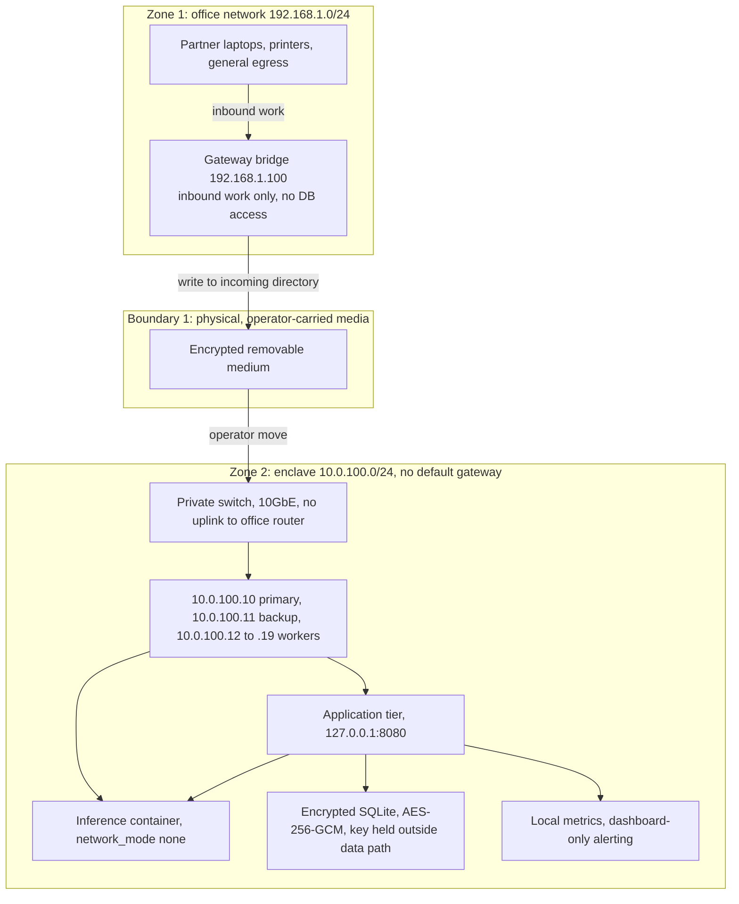
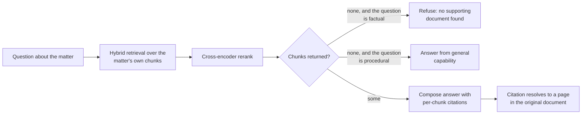

# Sovereign architecture

This document describes the target deployment topology in depth: the network
and hardware, the inference container, the gateway bridge contract, the
ingestion pipeline, the data model, the deployment story, and what happens
when things break.

Everything here is derived from internal deployment artifacts. No client
material is included, and no configuration values that would identify a firm
or a matter appear here.

## 1. Network topology

Three zones, separated by two boundaries that are physical rather than
logical.



**Zone 1, the office network.** Ordinary corporate network on `192.168.1.0/24`.
Laptops, printers, and whatever egress the firm has. Nothing in this zone can
route to the enclave: the enclave subnet is not advertised, and the switch that
carries it has no uplink to the office router.

**The boundary.** Crossing is by physical media under operator control. The
design assumes a two-person rule for the transfer and an encrypted volume. We
describe this as the strongest property of the deployment because it does not
depend on any software being correct. It is also the property most likely to
be socially defeated: a single person with a USB stick is a complete path
across the boundary, and no amount of network configuration changes that.

**Zone 2, the enclave.** A dedicated `10.0.100.0/24` subnet with no default
gateway. The hardening procedure removes the default route explicitly rather
than relying on the absence of a router to remove it, on the reasoning that an
explicit deletion survives a configuration mistake that an implicit omission
would not.

## 2. Hardware

| Component | Specification | Purpose |
|---|---|---|
| Compute nodes | 8 or more Mac Studio, M2 Ultra or M3 Max | Inference and application tier |
| Memory | 128 GB unified memory per node, 1 TB or more across the cluster | Model weights resident, no swap |
| Storage | 4 TB SSD per node, 32 TB or more across the cluster | Staged documents, database, backups, weights |
| Network | 10 GbE backbone on a dedicated switch | Node-to-node traffic |
| Switch | Private, no uplink to the office router | Prevents a physical uplink from silently reintroducing egress |
| Power | UPS with generator backup, 30 minute ride-through | Graceful shutdown for prolonged outages |

Unified memory is the reason this hardware is chosen rather than discrete
accelerators: a large open-weights model can be resident in memory without
quantization, which removes a class of quality loss from the evaluation.

The physical security envelope is not software and is listed here because it is
part of the architecture: a locked room, badge plus biometric access, a
two-person rule for media transfers, cameras with local-only storage,
temperature and humidity control, and clean-agent fire suppression.

## 3. The inference container

The inference container is the piece that matters most, because it is the
piece that holds the model.

```yaml
services:
  inference:
    image: deepseek-ai/deepseek-r1:latest
    container_name: vault_brain
    network_mode: none          # complete network isolation
    volumes:
      - /vault/models:/models:ro
      - /vault/chat_history:/history
      - /vault/incoming:/incoming:ro
    environment:
      - MODEL_PATH=/models/deepseek-r1-70b.gguf
      - CONTEXT_LENGTH=131072
      - N_GPU_LAYERS=100
    deploy:
      resources:
        limits:
          memory: 1.2T
    restart: unless-stopped
    security_opt:
      - no-new-privileges:true
    cap_drop:
      - ALL
    cap_add:
      - CHOWN
      - SETGID
      - SETUID
    read_only: true
    tmpfs:
      - /tmp:noexec,nosuid,size=100g
```

Each line earns its place:

* **`network_mode: none`.** The container has no network interface at all.
  There is no endpoint to call, no DNS to resolve, and nothing to exfiltrate
  to. This is the difference between a policy that says the container must not
  reach the internet and a mechanism that makes reaching it impossible.
* **Read-only model mount.** The weights are mounted read-only. The container
  cannot modify the artifact it runs, which means a compromised extraction
  path cannot persist a modified model.
* **Read-only root filesystem plus tmpfs.** Writable state lives in a
  `noexec,nosuid` tmpfs. There is nowhere for the container to drop an
  executable.
* **`cap_drop: ALL`** with three capabilities added back for the file
  ownership the storage layout requires, and `no-new-privileges` so that no
  setuid path is reachable from inside.
* **Memory limit and `restart: unless-stopped`.** A runaway inference is
  bounded, and the container comes back after a node reboot without an
  operator in the room.

The application tier binds to `127.0.0.1:8080` and reaches inference over a
unix socket, not TCP. The socket is a filesystem object with filesystem
permissions, which means the application tier's access to the model is
governed by the same rules as its access to the database.

## 4. The gateway bridge contract

The bridge is the only component that touches both networks, so its contract
is deliberately small.

| Property | Value | Reason |
|---|---|---|
| Address | `192.168.1.100` on the office network | Single, findable, auditable point |
| Egress to enclave | None | No route, no tunnel, no agent |
| Database access | None | The bridge cannot read or write the case database |
| Inbound work | Received via API, written to an incoming directory | It delivers files and nothing else |
| Outbound work | Produced files copied back to the bridge, carried out on media | Asymmetric by design, and visible at each step |

The reasoning behind the missing database access is that a bridge with
credentials is a bridge with something to steal. A bridge that can only
write files into a directory has a much smaller blast radius, even in the
worst case, because what an attacker gains is the ability to place files that
the enclave will then parse.

The bridge also scans what it receives before writing it into the incoming
directory. This is a coarse filter, not a substitute for the parsing
sandbox, and we do not describe it as one.

**Where we would spend the first security review.** The bridge. It is the
single component whose compromise defeats the design without any technical
sophistication, and it is the only component that handles untrusted input
while connected to a network.

## 5. Node hardening

The hardening procedure runs on each node at deployment. It is twelve steps,
and the last one is the one that matters:

1. Disable Wi-Fi radio.
2. Disable Bluetooth controller.
3. Enable full-disk encryption.
4. Enable the application firewall in global state, with stealth mode.
5. Disable remote login.
6. Deactivate remote management.
7. Create a dedicated non-admin service account with a random password.
8. Apply a password policy plist.
9. Remove automatic login.
10. Enable the audit subsystem.
11. Create the vault directory tree, owned by the service account, mode 750,
    with the secrets directory at 700.
12. **Delete the default route.**

Steps 1 through 11 are ordinary hygiene. Step 12 is the air gap. Removing
the default route explicitly is what makes the enclave unable to reach
anything, and doing it as a named step in a repeatable procedure means it can
be verified after the fact rather than assumed from the switch configuration.

## 6. Ingestion pipeline

The sequence, with the record written at each stage:

| Stage | Process | Cadence | Artifact written |
|---|---|---|---|
| Receive | Poller against the intake mailbox | 30 second poll | Message identifier recorded |
| Filter | Sender allowlist | on receipt | Rejected messages marked read, not processed |
| Stage | Attachments written to a per-job directory | per message | Job record with stable identifier |
| Parse | PDF, DOCX, TXT to text; OCR fallback below 100 chars per page | per file | Text, filename, timestamp in the loading zone |
| Extract | Three focused passes over staged documents | per job | Pass outputs, one field set each |
| Merge | Pass outputs combined | per job | Case record update |
| Record | Entity rows and processing log | per job | Entity rows with document identifier; log row with the action taken |
| Present | Case dashboard | on read | Nothing |

The parse stage's OCR rule is a threshold, not a classifier: a PDF page
yielding fewer than 100 characters of text is treated as image content and
routed through OCR. The threshold is a heuristic and its failure mode is
known: a scanned page that yields slightly more than the threshold of
nonsense text will not be routed to OCR, and the extraction pass will see
nonsense.

The three extraction passes are deliberately narrow, and the split was
originally a response to a hosted model output limit rather than a design
preference. It survives in the enclave because narrow field sets are easier to
evaluate, easier to audit, and easier to attribute when something goes wrong.
Pass one answers matter identity. Pass two answers the financial ledger.
Pass three answers deadlines. Each pass is re-runnable against the same
staged inputs.

**Idempotency.** Processed message identifiers are unique in the database, so
a redelivered message does not create a second job. This matters more than it
sounds: in a legal workflow the same document arrives more than once, through
more than one channel, and duplicate financial entries are exactly the kind of
error that survives into a damages summary unnoticed. Documents are also
content-hashed, so a re-uploaded file is recognized as the same file rather
than stored twice.

## 6.1 The retrieval path

The record is what the attorneys read, but the other half of the system is
the query path: an attorney asks a question about the matter and gets an
answer with citations back to specific documents.



Two properties of this path are worth naming because they bear on the audit
story.

**The empty-retrieval guard.** When retrieval returns no supporting chunk
and the question is a factual one about the matter, the system does not
answer it. It reports that the case file does not contain the evidence, and
it is instructed not to substitute what the model might know from training
and not to speculate about what the record might contain. When the question
is procedural rather than factual, a general answer is allowed, because
there is nothing to look up.

This is the deployment's answer to the hallucination problem at the query
side, and it is a partial one. It refuses when the evidence is absent, which
is the easiest case to detect. It does not check whether a returned chunk
actually supports the claim built from it. The extraction-side validator in
`src/extraction_schema.py` is the stricter check, and it applies to the
record rather than to the conversational answers.

**Citations resolve to the source.** A citation is not a filename. It
resolves to a specific location in the original document, so an attorney can
read the passage the answer rests on rather than take the system's word for
it. This is the difference between an answer that is checkable and one that
is merely plausible, and it is the property that makes a third-party audit
of the outputs meaningful rather than impressionistic.

Retrieval runs against the matter's own chunks, scored by a hybrid of
lexical and vector search and reranked by a cross-encoder before the answer
is composed. There is no shared index across matters, which is what makes
the per-matter scoping a privacy property rather than a configuration
setting.

## 7. Data model

SQLite with the JSON extension. The schema is organized around the matter.

### 7.1 Matter table

| Column | Type | Notes |
|---|---|---|
| `id` | INTEGER | Primary key |
| `case_name` | TEXT | Caption as stated in the source |
| `case_number` | TEXT | Docket number as stated in the source |
| `plaintiff_name` | TEXT | Party name |
| `defendant_name` | TEXT | Party name |
| `venue` | TEXT | Court or venue |
| `incident_date` | TEXT | Date as stated |
| `cause_of_action` | TEXT | |
| `injury_details` | TEXT | |
| `injury_summary` | TEXT | |
| `incident_location` | TEXT | |
| `status` | TEXT | `intake`, `discovery`, `mediation`, `trial`, `settled` |
| `total_value` | REAL | Aggregate, computed from the ledger |
| `total_economic` | REAL | Computed |
| `total_non_economic` | REAL | Computed |
| `next_deadline` | TEXT | Computed from the deadline rows |
| `discovery_counts` | JSON | `{"iq":0,"doc_req":0,"rfa":0}` |
| `parties` | JSON | Party names and roles |
| `interrogatories`, `doc_requests`, `admissions` | INTEGER | Discovery counters |
| `document_count`, `total_pages` | INTEGER | |
| `user_id` | INTEGER | FK to users |

### 7.2 Per-matter panels

| Column | Type | Notes |
|---|---|---|
| `id` | INTEGER | Primary key |
| `case_id` | INTEGER | FK to cases, cascade delete |
| `tab_type` | TEXT | Constrained to `overview`, `medical_ledger`, `calendar`, `documents`, `timeline`, `discovery`, `notes` |
| `tab_data` | JSON | Panel payload |
| `created_at`, `updated_at` | TEXT | |
| | | Unique on `(case_id, tab_type)` |

The type constraint matters for a reason beyond tidiness: it is the
enumeration that the audit artifact in `EVALUATION.md` and the field registry
in `src/extraction_schema.py` both check against, so an unrecognized panel
type is a detectable event rather than a silent one.

### 7.3 Ledger table

| Column | Type | Notes |
|---|---|---|
| `id` | INTEGER | Primary key |
| `case_id` | INTEGER | FK, cascade delete |
| `provider_name` | TEXT | Not null |
| `provider_npi` | TEXT | |
| `service_date` | TEXT | |
| `cpt_code` | TEXT | |
| `icd10_code` | TEXT | |
| `billed_amount` | REAL | Default 0 |
| `insurance_paid` | REAL | Default 0 |
| `write_off` | REAL | Default 0 |
| `patient_balance` | REAL | Default 0 |
| `form_type` | TEXT | Constrained to `CMS-1500`, `UB-04`, `UNKNOWN` |
| `source_document` | TEXT | The document this row came from |
| `attorney_override_amount` | REAL | Human correction |
| `attorney_notes` | TEXT | Human note |
| `created_at` | TEXT | |

### 7.4 Deadline table

| Column | Type | Notes |
|---|---|---|
| `id` | INTEGER | Primary key |
| `case_id` | INTEGER | FK, cascade delete |
| `deadline_type` | TEXT | Discovery, motion, hearing, trial, statute |
| `description` | TEXT | |
| `deadline_date` | TEXT | Not null |
| `rule_basis` | TEXT | The provision the date derives from |
| `reminder_14_sent`, `reminder_7_sent`, `reminder_1_sent` | INTEGER | Reminder flags |
| `ics_uid` | TEXT | Unique, for calendar export |
| `created_at` | TEXT | |

### 7.5 Entity and processing tables

`extracted_entities` carries `case_id`, `document_id`, `entity_type`,
`entity_value`, `entity_label`, a confidence value, and a timestamp. The
`document_id` column is the link that makes the record auditable: every
extracted value points at the document it came from.

`processing_log` carries the job identifier, the matter, the action, a
summary, and the timestamp. This is the table that makes "every extraction is
a recorded, re-runnable pass" true rather than aspirational.

`loading_zone` holds the job identifier, the filename, the full extracted
text, and the extraction timestamp. It is the staging area between parsing and
extraction, and it is why a pass can be re-run without re-parsing.

`case_documents` carries the original filename, the stored filename, the path,
the document type, the size, the extracted text, the processing status, the
processing error, and the timestamps.

### 7.6 Foreign keys and indexes

Foreign keys cascade on delete from a matter to its panels, ledger rows,
deadlines, documents, and entities. Indexes exist on the foreign key and on
the columns that are filtered: matter on the deadline and ledger tables,
`event_date` and `event_type` on the calendar, `processing_status` on
documents, `entity_type` on entities.

## 8. Deployment story

The sequence a firm actually goes through:

1. **Prepare the room.** Physical security, power with UPS and generator, and
   a dedicated switch with no uplink to the office router.
2. **Install and harden the nodes.** The twelve-step procedure, with the
   default-route deletion verified rather than assumed.
3. **Load the model.** Weights are transferred on media, verified by checksum
   against the published artifact, and mounted read-only.
4. **Seed the configuration.** Model path, context length, socket path,
   database path and encryption key file, the extension allowlist, the maximum
   file size, and the requirement that inbound media be signed.
5. **Stand up the bridge.** On the office network, with no route to the
   enclave and no database credentials.
6. **Start the tiers.** The inference container, then the application tier
   bound to localhost, then the local metrics collector.
7. **Verify the isolation, from inside.** Confirm the enclave cannot reach
   the internet, confirm the inference container has no network interface,
   confirm the application tier reaches the model only over the socket, and
   confirm the switch has no uplink. This verification is a deployment step,
   not an assumption.

   The internal artifacts include a sovereignty-audit script that blocks the
   public interface and then checks that the internal one still answers. That
   script was written for the VPN-connected development path, where a public
   interface exists to block. The enclave has no such interface to block, so
   the equivalent check here is simpler and we state it as a step we
   recommend rather than as a tool that ships: run it, and record the result
   in the deployment log.
8. **Restore from backup.** The backup set is encrypted, and the restore path
   is exercised during deployment rather than discovered during an incident.

The container deployment kit that supports steps 5 through 8 defines two
services: the application tier and a separate email-processor sidecar, with
health checks on an interval and a start period that allows for cold start.
It also defines persistent volumes for data, documents, and logs, and a
bridge network. The kit's configuration surface includes firm identifier,
firm name, intake address, port, authentication toggle, allowed domains,
maximum upload size, processing timeout, and rate limit.

**One honest caveat about the kit.** It also contains a path that provisions
cloud infrastructure. That path is the opposite of an air gap. We keep it
because a deployment kit that can only describe one topology is a kit that
describes the wrong topology for a firm that has already decided. It is not
part of the enclave configuration, and we do not describe it as such.

## 9. Failure modes

| Failure | Detection | Response | Residual risk |
|---|---|---|---|
| Removable media lost or not returned | Physical count at transfer | Reissue, rotate the transfer encryption key | The medium may have been copied before loss |
| Bridge compromised | Office-side monitoring, access log review | Isolate the bridge on the office network, preserve logs, rebuild it | Files already placed in the incoming directory may be hostile |
| Bridge writes a hostile document | Parser errors, extraction producing fields with no support | The grounding validator flags the field; the attorney rejects the row | A document engineered to produce well-supported but misleading fields |
| Node fails | Local health check, metrics | Hot-swap to the backup node, restore from the local backup set, investigate the failed hardware off-network | Work in flight on the failed node is lost since the last backup interval |
| Whole cluster unavailable | Local alerting only | Restore from the weekly full image | The backup interval is the recovery point objective; nothing observes the cluster while it is down |
| Model needs updating | Discovered internally, or by the operator | Transfer new weights on media, verify checksum, run the conformance battery before promotion | Until someone notices, the stale model keeps serving |
| Application tier compromised | Audit log review | Rebuild the tier from the known image, restore the database | Extracted values already written by the compromised tier stay in the record until re-extraction |
| Disk fills | Alert at 80 percent utilization | Rotate logs, prune the loading zone | Pruning the loading zone removes the re-runnable input for old passes |
| Backup fails | Daily backup integrity check | Re-run, then repair the backup target | Between a failed backup and its repair there is a window with no new backup |

Two of these deserve emphasis because they are structural rather than
incidental.

**The stale model is the quiet failure.** Every other row in the table
produces a signal. A model that has quietly degraded does not, because the
enclave has no way to notice that what it is producing has changed character.
The only detection path is an internal conformance battery, and until that
battery exists, the detection path does not exist. This is the operational
face of research question Q3 in the README.

**The bridge is the sharp edge.** It is the one component with a network
connection and untrusted input, and it is the shortest path from the office
network into the enclave. Everything else in the design assumes it holds.

## 10. Backups

| Interval | Artifact | Location |
|---|---|---|
| Hourly | Incremental database backup | Enclave-local |
| Daily | Full database dump | Enclave-local |
| Weekly | Complete system image | Enclave-local |
| Monthly | Encrypted backup | Removable media, physically transported, never connected |

The monthly off-site copy is the one that leaves the building, and it leaves
by the same media path as everything else. It is encrypted and it is never
connected to a network.

There is no legal hold implementation. The backup schedule is a backup
schedule. Anything that requires retention against a client's instruction or
against a preservation notice requires a process outside this system, and we
do not claim the system provides one.
