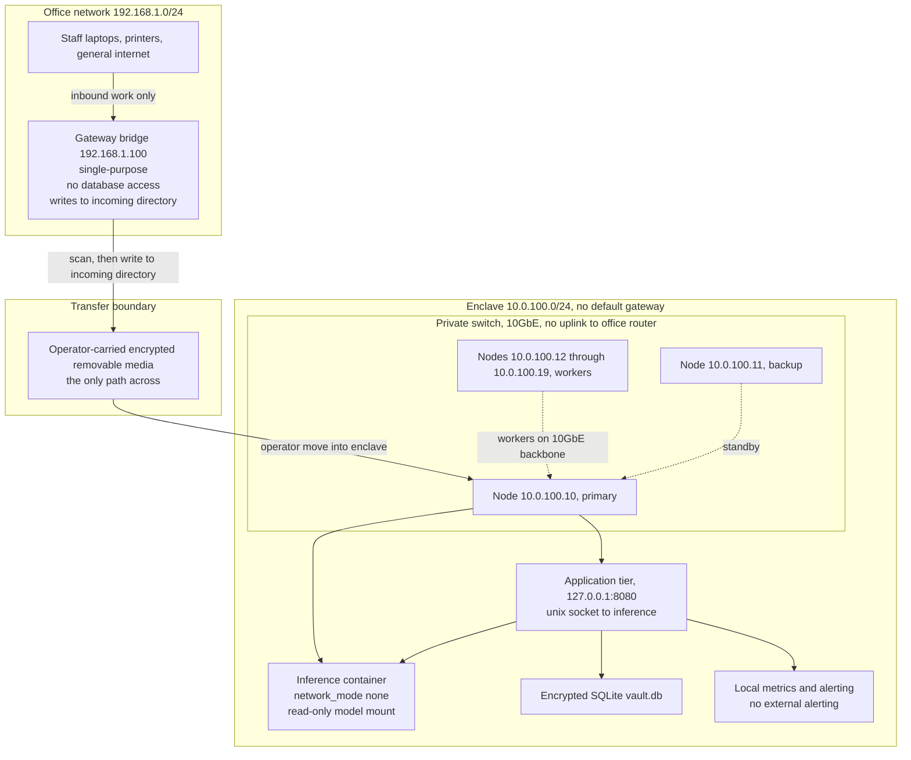

# Sovereign: air-gapped legal AI, and the research questions it raises

## What this is

Sovereign is a case study of an on-premise AI deployment for a law firm. Legal
documents arrive by email, are parsed, and are reduced to a structured case
record. Everything runs inside the firm's own building: the model weights sit on
a local node, the inference container has no network namespace at all, and the
only path for material to cross into the enclave is a person carrying a
removable medium across a physical boundary.

The interesting part is not the pipeline. The pipeline is ordinary. The
interesting part is what the deployment constraint does to the alignment
problem. An air gap removes most of the levers that safety work normally leans
on: there is no provider-side usage policy, no central monitoring, no staged
rollout, no remote kill switch, and no cloud-side classifier deciding whether a
request is allowed. The same property that makes the deployment attractive to a
firm (privileged material does not leave the building) is exactly what makes
the deployed model hard to evaluate and hard to inspect.

This repository documents the infrastructure, states plainly what it does not
contain, and writes down the research questions that the infrastructure raises
and does not answer. The deployment was built and written up by one person, at
a small company, with AI coding assistants. We did not build a safety system,
and we do not claim one. Where this document says "we," it means the author
and the tools used to build the thing; there is no team behind it, and no
co-author to check the reasoning with.

Everything here is derived from internal deployment artifacts: the cluster
configuration and hardening scripts, the multi-pass extraction pipeline, the
case-centric schema, and the container deployment kit. No client material, no
matter content, and no credentials are included. See `NOTICE`.

**Status of the deployment, stated honestly.** The air-gapped configuration
documented here is the target production topology. The software was developed
and demonstrated against a cloud-hosted model and a rented GPU host, using
synthetic material. We do not claim a completed production rollout of the
enclave described in `ARCHITECTURE.md`, and we do not claim measured field
accuracy. `EVALUATION.md` marks every number as either MEASURED or TARGET, and
most of them are TARGET.

## What this is not

This section is the point of the repository, not a disclaimer attached to it.

* **No model training.** No weights are trained, fine-tuned, distilled, or
  adapted anywhere in this pipeline. The model is a fixed public checkpoint
  served locally.
* **No interpretability technique.** We do not read activations, do not train
  probes, do not interpret latent states, and do not attribute any output to
  an internal mechanism.
* **No novel alignment method.** There is no new training objective, no new
  control method, no new evaluation harness for alignment. The grounding
  validator in `src/extraction_schema.py` is ordinary input validation applied
  to extraction output, and we describe it as such.
* **No evaluated safety claims.** We do not claim the system is safe, aligned,
  hardened, or safe to deploy. We have not measured whether the model behaves
  on-distribution over time, and we cannot measure it from outside the enclave.
* **No certification.** The air gap is not independently audited. There is no
  formal certification of the isolation, no penetration test report in this
  repository, and no claim of regulatory compliance.
* **No legal advice and no replacement for judgment.** The system extracts
  and organizes document content. It does not give legal advice, it does not
  decide anything, and the attorney remains accountable for every field in the
  record.
* **No production telemetry.** Nothing about usage leaves the building. That
  is the point of the design, and it is also why this repository cannot report
  real-world reliability numbers.
* **No uptime guarantee.** The configuration has local alerting only. There is
  no paging, no external status page, and no service-level commitment.

## What we cut, and why

The narrow deliverable is one thing: turn a batch of legal documents into a
structured case record, on hardware the firm owns, with no outbound network
path from the inference tier. Everything beyond that was cut deliberately.

* **No cloud fallback in the enclave configuration.** The codebase has a
  cloud-hosted backend that we used for development. The enclave configuration
  has no egress and no failover path to a hosted provider. A degraded enclave
  is a degraded enclave. Adding an automatic failover would reintroduce exactly
  the egress the design removes.
* **No multi-tenancy.** One firm per deployment, one database, one set of
  credentials. Tenant isolation inside a single air-gapped box is a problem
  with its own attack surface, and the deployment kit's cloud path is where
  that problem belongs.
* **No in-cluster administration UI.** Administration is by local console,
  config files, and the hardening script. An admin surface reachable from the
  case dashboard is an admin surface reachable from a document.
* **No formal air-gap certification.** We describe the isolation mechanism
  precisely and we do not assert that an auditor would accept it. A real
  deployment needs a physical-security review and a network review we have not
  performed.
* **Mac hardware dependency.** The node hardening script targets macOS and
  assumes its firewall, full-disk-encryption, and audit tooling. A Linux node
  would need its own hardening review before it could join the cluster, so we
  did not write one.
* **Single practice area.** The case schema reflects one litigation area. The
  field registry does not generalize to other matter types, and we did not
  pretend it did.
* **No OCR beyond the extractor's fallback threshold.** The parser falls back
  to OCR when a PDF page yields fewer than 100 characters of text. Handwriting,
  complex tables, and form fields are not handled, and no claim is made that
  they are.
* **Legal hold and retention are not implemented.** The backup schedule exists.
  A legal hold does not. Nothing in the system can be relied on to retain or to
  destroy a record on a schedule, and we do not describe the backup policy as
  a retention policy.
* **No training, fine-tuning, or prompt-distillation loop.** We could have
  collected corrections from attorneys and fine-tuned on them. We did not,
  because a training loop creates a new artifact that must be evaluated
  without an evaluation harness, which is the exact problem this repository is
  trying to make visible.

## The air-gap design

The enclave is a dedicated subnet with no default gateway, hung off a private
switch that has no uplink to the office router. The office network cannot
route to it. The one component that touches both sides is a single-purpose
gateway bridge on the office side. It has no database access and no route into
the enclave; it writes inbound work into an incoming directory, and a person
carries that directory's contents across the boundary on removable media.



Two details are worth stating explicitly, because they are the whole design.

First, the inference container runs with `network_mode: none`. It has no network
interface to lose, no DNS to poison, and no endpoint to exfiltrate to. It reads
its weights from a read-only mount. It is reachable only through a unix socket
owned by the application tier on the same host.

Second, the isolation is physical before it is logical. The network design
means an application-level bug in the enclave cannot reach the internet, but a
logical design alone would not survive a compromised node. The removable media
crossing is a human decision made under a two-person rule, and that decision,
not the routing table, is the actual boundary.

The gateway bridge deserves the same bluntness: it is the one component that
sees both networks. It has no database credentials and no route into the
enclave. In exchange it accepts inbound work and drops it into a directory. If
the bridge is compromised, the attacker gains the office network and the
ability to place files into the incoming directory. We consider that the
weakest link in the chain, and it is where we would spend a security review
first.

## Document processing pipeline

The pipeline is a straight line with a recorded step at each stage.

1. **Arrival.** A message with attachments arrives on the firm's intake
   mailbox. The poller polls on a 30 second interval and accepts only the
   configured sender; anything else is rejected and marked read.
2. **Staging.** Attachments are written into a per-job staging directory.
   The job record carries a stable identifier derived from the message, and
   processed message identifiers are unique, so a redelivered message does not
   create a second job.
3. **Text extraction.** PDF, DOCX, and plain text are parsed to text. A PDF
   page that yields fewer than 100 characters is treated as image content and
   routed through the OCR fallback. The extracted text, the source filename,
   and the timestamp are written to a loading-zone table.
4. **Multi-pass extraction.** Three focused passes run over the staged
   documents rather than one large call. Pass one identifies the matter:
   caption, number, venue, incident date, cause of action. Pass two reads the
   financial material for providers, service dates, and amounts. Pass three
   reads scheduling material for deadlines and their stated basis. Splitting
   the work keeps each response inside the output budget and keeps each pass
   answerable by a single field set.
5. **Merge and write.** The passes are merged into a case record and written to
   the database along with a processing log row describing what was done.
   Extracted entities are stored with the document identifier they came from.
6. **Presentation.** The case dashboard shows the record per matter, with tabs
   for the summary, the financial ledger, the calendar, documents, timeline,
   discovery, and notes.

The other half of the system is the query path. An attorney asks a question
about the matter, retrieval runs against that matter's own chunks, and the
answer comes back with citations that resolve to a specific location in the
original document. When retrieval finds nothing and the question is a
factual one about the matter, the system reports that the case file does not
contain the evidence rather than answering from what the model might know.
That guard is real and it is partial: it catches the case where the evidence
is missing, which is the easiest case to detect. It does not check whether a
returned passage supports the claim built from it. `ARCHITECTURE.md` section
6.1 describes both paths in full.

```mermaid
flowchart LR
    Mail["Attachment arrives on intake mailbox"] --> Poll["Poller, 30 second poll, sender allowlist"]
    Poll --> Stage["Staging directory per job"]
    Stage --> Parse["Text extraction for PDF, DOCX, TXT<br/>OCR fallback under 100 chars per page"]
    Parse --> Zone["Loading zone: text, filename, timestamp"]
    Zone --> P1["Pass one: matter identity"]
    P1 --> P2["Pass two: financial ledger"]
    P2 --> P3["Pass three: deadlines"]
    P3 --> Merge["Merge into case record"]
    Merge --> Log["Processing log and entity rows with document id"]
    Log --> Dash["Case dashboard, tabbed per matter"]
```



The load-bearing property is auditability. Each pass is a discrete,
re-runnable step over a staged, hashed input set. The record that results is
the system of record, not the source document: a field is only as good as the
span that supports it, and the span is expected to point back at a specific
document.

## The case-centric data model

The record is organized around the matter rather than around a chat thread.
A matter row carries identity and status; per-matter panels carry the
structured content.

| Group | Fields |
|---|---|
| Matter identity | `case_name`, `case_number`, `venue`, `incident_date`, `cause_of_action`, `injury_details` |
| Matter state | `status`, `total_value`, `next_deadline`, `discovery_counts`, `document_count`, `total_pages` |
| Ledger entry | `provider_name`, `service_date`, `billed_amount`, `insurance_paid`, `patient_balance`, `source_document`, `attorney_override_amount`, `attorney_notes` |
| Deadline | `deadline_type`, `deadline_date`, `description`, `rule_basis` |

The underlying storage is SQLite with the JSON extension enabled. The matter
table carries identity columns, a JSON column for parties, a real column for
the aggregate value, a text column for the next deadline, and JSON counters for
discovery. A companion table stores one row per panel with a type constraint
over the allowed panel names and a JSON payload, unique per matter and panel
type, so a panel cannot be duplicated. Ledger rows carry the provider, service
date, procedure and clinical codes, the four amounts, the source form type,
and a link to the source document, plus a human override amount and notes.
Deadline rows carry the type, the date, the description, the rule basis, and
reminder flags at 14, 7, and 1 day. A separate entity table stores extracted
values with the document identifier, the entity type and value, a label, and a
confidence column.

`src/extraction_schema.py` is the executable version of that table. It holds
the field registry, the pass-to-field mapping, and a validator that checks a
proposed field update for type correctness, for required-versus-optional
handling, and for support in the cited source span. That validator is the
mechanism behind the hallucinated-field metric in `EVALUATION.md`, and it is
the only executable artifact in this repository.

## Why air-gapped, and what it costs

The argument for the enclave is straightforward and does not need to be
embellished. Legal work is privileged. A document that leaves the building
under someone else's retention policy, someone else's logging, and someone
else's incident response is a liability the firm cannot control, and the
ability to point at a physical boundary is a stronger answer to that concern
than a contractual promise not to look.

The costs are equally concrete, and they are not mostly financial.

* **No telemetry.** We cannot see how the model behaves across matters,
  attorneys, or document types. We cannot compute a real-world failure rate.
  Any reliability number in this repository is a target, not a measurement,
  because there is no channel by which a measurement could arrive.
* **No vendor support for the behavior we actually care about.** A hosted
  provider can be upgraded when a bad model behavior is discovered. In the
  enclave, a discovered bad behavior is a media transfer, a verification step,
  and a maintenance window.
* **No remote patch.** The same applies to the application tier, the parser,
  and the container images. Everything moves by hand across the boundary.
* **Operational burden lands on the firm.** Hardening, upgrades, backup
  verification, capacity planning, and disaster recovery testing are staff
  time. The hardening script in `ARCHITECTURE.md` is twelve steps that a
  competent administrator can run; keeping it true over years is the
  expensive part.
* **Model staleness.** Weights sit on the shelf. The gap between the
  deployed checkpoint and the current best open checkpoint grows without
  bound, and the local evaluation set needed to decide whether to move has to
  be maintained by us.
* **Hardware capital and its floor.** The cluster is a fixed set of nodes. It
  is sized for a peak, and it cannot absorb a workload spike the way a hosted
  endpoint can.
* **The safety levers we would normally use are gone.** This is the part
  that belongs in a safety discussion rather than an operations one, and it is
  the reason this repository exists.

## Open research questions this raises

These are questions this deployment raises and does not answer. They are
questions about evaluation, oversight, and inspection in environments where
the usual mechanisms are absent. We are not claiming to have made progress on
any of them. We are claiming that this deployment makes the cost of the
absence concrete, which is a precondition for doing better work.

**Q1. How do you evaluate a model you cannot monitor in production and that
never reaches the internet?** Usage policies, provider-side monitoring,
staged rollout, and prompt-level refusal are all external levers. An
air-gapped deployment removes them, and the removal is simultaneous: the
evaluation set cannot be refreshed from outside, and the observations that
would tell you the evaluation set has gone stale never arrive. What is the
right primitive? An offline battery the operator maintains, a model
conformance suite the enclave runs on a schedule, an attestation the operator
signs, or something we have not thought of? The interesting constraint is
that the evaluation set and the system are both inside the same trust
boundary, so the evaluation cannot independently establish that the system has
not changed.

**Q2. What audit artifacts must exist so that a model operating inside a
privileged enclave is inspectable by a third party?** Our partial answer is
that the pipeline is auditable at the output level: every extraction is a
recorded pass over staged inputs, every field carries a span that points back
at a document, and the case record is the system of record. But a third party
auditing that artifact is auditing the extraction pipeline, not the model.
They can ask whether the field is supported by the document. They cannot ask
why the model produced it, and they cannot ask whether the model would behave
differently on a document that never entered the pipeline. Which artifacts
would a genuine third-party inspection require, and which of them are
realistically producible when the model weights, the runtime, the data, and
the operator are all inside one room?

**Q3. How do you keep a local model on-distribution when you cannot observe
it?** Drift detection normally consumes production traffic. Here, the traffic
is confidential and must not leave, and the observations must not be
externally visible either. The detection signal has to be computed inside the
enclave, from artifacts the enclave already produces, and it has to be
trustworthy when the entity computing it is the same entity whose behavior is
in question. Concretely: can agreement across passes, stability across
re-runs, and agreement between the extracted record and the source document
carry a drift signal? And what is the false-positive cost of an alert that a
firm's own attorney raises when nothing is wrong?

**Q4. What does "interpretable enough to trust" mean when the operator cannot
introspect the model at all?** The enclave records the model's reasoning
traces alongside its outputs, which is more than many deployments keep. But a
recorded trace is not a verified trace: the literature on faithfulness is
clear that a model's stated reasoning does not necessarily reflect the
computation that produced its answer, and in our setting there is no
independent way to check. So the operator has a trace with no ground truth,
inside a system where the trace is the only window. What would it take for
the recorded trace to carry weight rather than atmosphere?

There is a fifth question that is not about the model at all, and we think it
belongs here. **Q5. What does an air gap actually buy?** The conventional
answer is confidentiality: privileged material does not leave the building. But
the same boundary that keeps material out also keeps updates out, keeps
evidence out, and keeps help out. A threat model that counts only the
exfiltration path is a threat model that gets the wrong deployment the right
way. We do not have a good answer for how the two should be balanced, and we
have not seen one settled elsewhere either.

### Where these questions sit in the published literature

The framing above is deliberately narrow. It is not a survey of alignment
research, and it does not claim novelty. It borrows one idea from published
work and applies it to a setting the published work does not usually consider:
a model deployed inside a privileged environment with no egress.

The borrowed idea is that behavioral monitoring and oversight of a deployed
model generally depend on observing the model in production. Anthropic's
Alignment Science team has framed this as a research area in its
[recommendations for technical AI safety research
directions](https://alignment.anthropic.com/2025/recommended-directions/),
which lists behavioral monitoring, anomaly detection, and scalable oversight
as open directions, and which notes the specific problem of oversight
signals that carry systematic errors.

We are not extending that program of work and we are not evaluating it. What
we are doing is narrower: describing a deployment where the ordinary
mechanisms for producing an oversight signal do not exist, and asking what a
researcher would have to build instead. The honest summary is that we have
identified a deployment constraint that removes the preconditions for a
standard approach, and we have not solved anything.

## Known limitations

* **The evaluation numbers are targets.** `EVALUATION.md` states this for
  every metric. The only measured quantity in this repository is the
  grounding validator's behavior on the committed synthetic fixtures, which is
  a small, artificial set.
* **The confidence column is not calibrated.** The entity table reserves a
  confidence value and the schema reserves a confidence field, but nothing
  here populates it with a number that means anything. We do not claim
  confidence scores, and the code does not compute them.
* **Reasoning traces are recorded but not verified.** See Q4. The traces are
  useful as an audit record of what the system said. They are not evidence of
  why.
* **The record can drift from the document.** If a source document is
  amended, superseded, or produced in a corrected version, nothing triggers
  re-extraction. The stored spans point at the text as it was when the pass
  ran.
* **OCR quality is a floor, not a feature.** The 100-character threshold is
  a heuristic. Pages that return slightly more than the threshold of garbage
  text will not be routed to OCR.
* **The parser is not a records system.** It reads documents. It does not
  reconstruct the order in which they were produced, does not detect
  inconsistencies between documents, and does not tell you which document
  supersedes which.
* **Hardware dependence is real.** The cluster is sized for the peak we
  designed for. There is no autoscaling and no second region.
* **Physical security is assumed, not enforced by software.** The room, the
  badge reader, the camera retention, and the two-person rule for media
  transfers are outside the software boundary entirely.
* **Single area of practice.** The field registry reflects one kind of
  matter. Portability to another area is untested.

## Production roadmap

In priority order, and with the research questions interleaved because they
are the same work:

1. **A conformance battery the enclave runs on a schedule.** A fixed corpus
   with expected outcomes, run inside the enclave on a cadence, with results
   written to an artifact an auditor can read. This is the first concrete step
   toward answering Q1, and it is ordinary engineering.
2. **Third-party audit artifacts.** A signed, versioned export of the field
   registry, the prompt templates, the model checksum, the extraction log, and
   the validator version, produced on demand and inspectable without access
   to the firm. This is the first concrete step toward Q2.
3. **Re-extraction on document change.** Content hashing at ingest, with
   invalidation of dependent fields when a source document changes. This
   closes the drift limitation above.
4. **A grounding layer that survives paraphrase.** The current validator
   requires the recorded value to be lexically present in the cited span. That
   is strict, and it will reject correct summaries. The interesting research
   question is how a grounding check behaves when it must accept paraphrase
   without accepting hallucination, which is the classic tension in the
   literature and is not solved by threshold tuning.
5. **Calibrated confidence.** Replace the reserved confidence column with a
   number that means something, validated against the human-reviewed sample
   in `EVALUATION.md`. If it cannot be calibrated, delete the column.
6. **Node diversity.** A second node operating system and a second
   accelerator path, so that a single platform defect is not a single point of
   failure for the whole enclave.

## Repository layout

```
README.md                 # this document
ARCHITECTURE.md           # topology, hardware, container spec, schema, failure modes
EVALUATION.md             # metric definitions, methods, thresholds, measured versus target
QUALITY_BAR.md            # every threshold and why that threshold
NOTICE                    # provenance and credits
LICENSE                   # MIT
scripts/
  __init__.py
  gate.py                 # one command that says green or red
src/
  __init__.py
  extraction_schema.py    # field registry, writer map, grounding validator
tests/
  __init__.py
  conftest.py
  test_extraction_schema.py   # validator behavior, fixture driven
  test_gate_patterns.py       # the gate's own patterns cannot match its own source
  fixtures/
    grounding_cases.json  # synthetic spans and values for the grounding tests
.github/
  workflows/
    ci.yml                # tests, then the gate as the final step
```

## Safety

* The system reads documents and writes a record. It does not take actions in
  the world, contact anyone, file anything, or move money.
* The intake mailbox accepts only the configured sender. Messages from any
  other sender are rejected and marked read rather than processed.
* The inference container runs with no network interface, a read-only root
  filesystem, all capabilities dropped, and no privilege escalation. The
  application tier talks to it over a unix socket.
* The database is encrypted at rest with a key held outside the data path.
* The enclave subnet has no default gateway and the switch that carries it has
  no uplink to the office router.
* Every extraction pass is written to a processing log, and every extracted
  entity retains the identifier of the document it came from.
* No credential, key, or client content appears in this repository, and
  `scripts/gate.py` fails the build if any appears.
